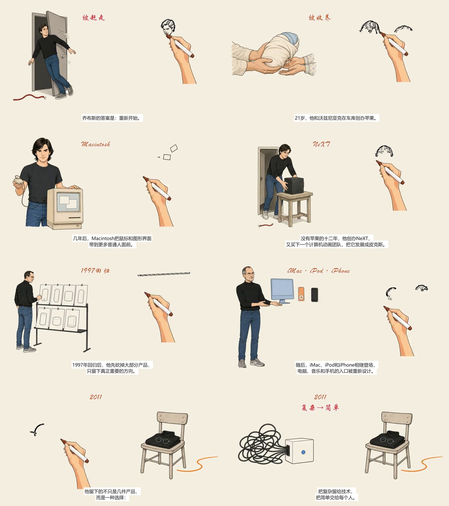
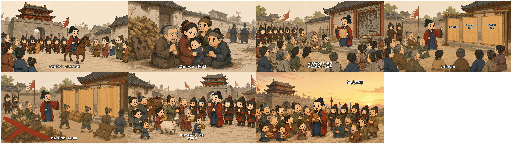
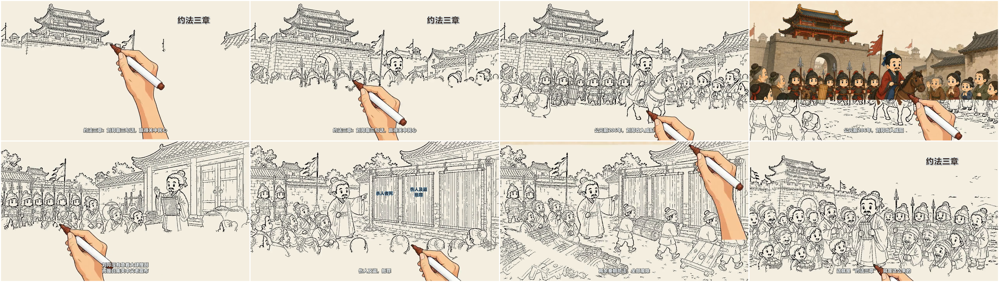
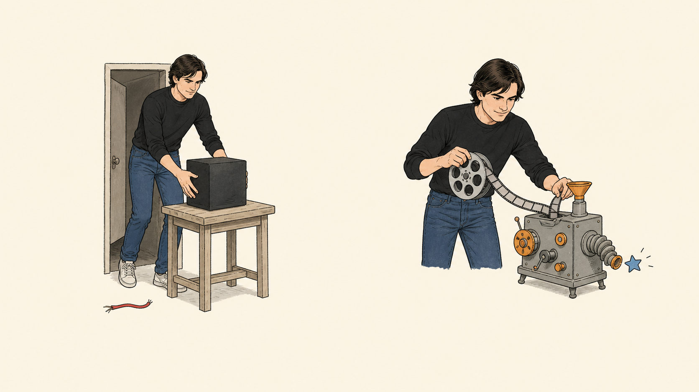
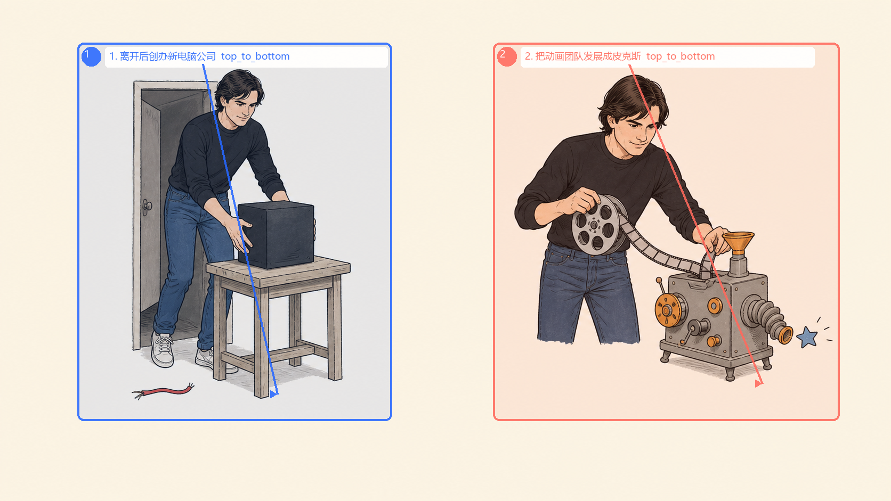

# Hand-Drawn Explainer Video — Nikola

Original author: Nikola | Contact: [X / Twitter @Nikola314159](https://x.com/Nikola314159)

A Codex skill for educational explainers that turns topics, scripts, or SRT subtitles into videos that draw as they narrate. Deliverables include a real MP4, subtitles, a timeline, and editable assets. The upstream author developed the project through repeated experimentation and welcomes feedback and pull requests.



## What it does

The skill has exactly two production routes. Composition and visual style are independent choices within the stroke-story route.

```text
Production routes
├─ Stroke-by-stroke storytelling
│  ├─ Composition: single scene / multi-scene story / dual semantic islands
│  └─ Style: chibi characters / Xiaohei / other hand-drawn styles
└─ Programmatic animation
   ├─ HTML / SVG / GSAP
   └─ Process cards / relationships / precise text / knowledge graphics
```

Dual semantic islands draw and explain the left side first, then the right, retaining earlier content. Single scenes and continuous multi-scene stories are also supported. Natural-skin-tone chibi characters suit biographies and history; Xiaohei suits abstract ideas, methods, and metaphors. Either style can use any composition.

Prompt-only delivery for Flow, Nano Banana, or other image/video models is supported; it is not a third production route. The bundled MIT backend enables real stroke-by-stroke drawing. The final video, audio, subtitles, scene boundaries, and last frames must be checked.

## Choosing a route

| Request | Default route |
|---|---|
| Draw as you narrate; reveal each stroke; follow the lines with the pen | Stroke storytelling |
| Draw the left side, then the right, and write keywords | Stroke storytelling with dual semantic islands |
| Xiaohei, whimsical minimal line art, white background, restrained colored notes | Stroke storytelling with Xiaohei style |
| Process cards, relationships, precise labels, independent motion | Programmatic animation |
| Image or image-to-video prompts only | Prompt-only mode |

See [Styles](docs/STYLES.md).

## Examples

The bundled examples are original upstream demonstration media. Their visual and audio language may differ from the English documentation; they are not English narration samples.

### Three Articles of Law: 16:9 multi-scene stroke story





- [38.5-second 16:9 MP4 with smoothed hand motion](examples/stroke-story/yuefa-sanzhang/yuefa-sanzhang-16x9-stroke-story.mp4)
- [Editable project archive](examples/stroke-story/yuefa-sanzhang/editable-project.zip)
- [Seven-scene structure, timeline, and validation](examples/stroke-story/yuefa-sanzhang/README.md)

Seven continuous story scenes each start on blank paper and reveal one complete event. The older 9:16 single-canvas sample suffered from interference between characters, props, and background lines and is not the recommended example.

### The Life of Steve Jobs: natural-skin-tone chibi characters and dual semantic islands





- [Full 57-second sample](examples/stroke-story/steve-jobs/steve-jobs-biography.mp4)
- [8.9-second representative dual-island shot](examples/stroke-story/steve-jobs/semantic-island-sample.mp4)
- [Source, regions, and timing](examples/stroke-story/steve-jobs/README.md)

### What Is a Skill? Programmatic animation


- [14-second MP4 sample](examples/program-animation/skill-demo/what-is-skill-sample.mp4)
- [Editable HTML/SVG/HyperFrames project](examples/program-animation/skill-demo/README.md)

The demo illustrates process cards, character motion, subtitles, and a real narration timeline. GSAP browser files are installed through npm, not redistributed. The upstream full commercial-skills production comprised 44 scenes and lasted 7 minutes 29 seconds; the downloadable 36-second project is a simplified public example.

| Aspect | Programmatic knowledge graphics | Stroke-by-stroke storytelling |
|---|---|---|
| Appearance | Independent cards, characters, arrows, and text move, scale, switch, or trace | Persistent canvas reveals semantic regions, line art first and then color |
| Technology | HTML/SVG + GSAP + HyperFrames | Raster line extraction + skeleton/stream paths + region masks |
| Best for | Processes, rules, relationships, comparisons, precise text | Biographies, history, whiteboard stories, progressive illustration |
| Boundary | Hand-drawn-style element motion is not genuine stroke drawing | Fades, flying cards, and SVG movement must not masquerade as ink strokes |

## Narration defaults

Reuse a qualified audio track that matches the script before synthesizing new narration. The upstream Volcengine preset is Liu Fei (`zh_male_liufei_uranus_bigtts`) with resource `seed-tts-2.0`. It is retained for compatibility; for English, use a user-approved English-capable authorized voice or supplied recording. Voice availability must be verified with the provider.

To use Volcengine, activate Speech Synthesis 2.0 in the provider console. [Original provider setup screenshot](docs/assets/volcengine-seed-tts-2-setup.png) (localized upstream interface).

Do not silently fall back to system speech or edge-tts. If suitable authorized narration is unavailable, preserve visuals, subtitles, and timelines and report the narration gap. See [voiceover and alignment](references/voiceover.md).

## Installation

Clone this fork into the Codex skills directory:

```powershell
git clone --branch localization/english-only https://github.com/Centaurioun/hand-drawn-explainer-video.git "$env:USERPROFILE/.codex/skills/hand-drawn-explainer-video-nikola"
python "$env:USERPROFILE/.codex/skills/hand-drawn-explainer-video-nikola/scripts/setup_check.py"
```

Prompt-only mode is ready after installation. Scripts require Python 3.10+ (on Windows, use a verified interpreter such as `py -3.12` if necessary). For stroke rendering:

```powershell
cd "$env:USERPROFILE/.codex/skills/hand-drawn-explainer-video-nikola"
python vendor/srt-whiteboard-animation/scripts/prepare_env.py
python scripts/stroke_story_preflight.py --report preflight-stroke-story.json
```

Complete MP4 production requires FFmpeg/FFprobe. Programmatic animation requires Node.js, a browser, and HyperFrames. See [Installation](docs/INSTALL.md), [Configuration](docs/CONFIGURATION.md), and [Troubleshooting](docs/TROUBLESHOOTING.md).

The stroke renderer requires neither GPU nor local neural-network weights. With suitable source art and narration, traditional local image processing is sufficient. First-time Python/npm installation requires internet access; new illustrations or cloud narration may require external services.

## Example prompts

```text
Use $hand-drawn-explainer-video-nikola to turn the following script into a 45-second English hand-drawn explainer. Draw the left side first, then the right, preserving earlier content. Add precise keywords using deterministic text. Use natural-skin-tone chibi characters. Verify a representative shot and deliver the actual MP4, SRT, timeline, and editable assets.
```

```text
Use $hand-drawn-explainer-video-nikola to explain this method in Xiaohei style: pure white, sparse black lines, and restrained red/orange/blue annotations. Reveal real strokes, not static-image zooms. Keep all subtitles and keywords accurate.
```

```text
Use $hand-drawn-explainer-video-nikola to make a hand-drawn-style process-card animation. Use editable SVG/HTML, render titles, numbers, and arrow relationships deterministically, and verify the final MP4.
```

## Repository structure

- `SKILL.md`: authoritative trigger and workflow.
- `references/`: stroke stories, semantic islands, programmatic animation, audio, and quality standards.
- `scripts/`: preflight, narration helpers, final composition, and validation.
- `vendor/srt-whiteboard-animation/`: attributed MIT stroke runtime, not a second skill.
- `examples/`: public samples, source illustrations, and editable projects.
- `docs/`: installation, configuration, architecture, styles, and troubleshooting.

## Safety and costs

No API keys, tokens, cookies, private paths, or private models are distributed. Cloud narration, image, and video generation are optional and may incur fees. Dry-run first, reuse matching caches, and avoid blind retries. See [SECURITY.md](SECURITY.md).

## Licensing

The skill, original scripts, and documentation are under [Apache 2.0](LICENSE). The bundled stroke runtime retains its upstream MIT license. Example media are covered by the [CC BY 4.0 media notice](LICENSE-MEDIA.md) only to the extent the author has redistribution rights. Third-party software, names, and trademarks are not relicensed; see [THIRD_PARTY_NOTICES.md](THIRD_PARTY_NOTICES.md).

Contributions to styles, regression coverage, and rendering are welcome; see [CONTRIBUTING.md](CONTRIBUTING.md).

## Acknowledgments

The upstream project credits the following open-source work; see [third-party notices](THIRD_PARTY_NOTICES.md) for attribution and code boundaries:

- [kaomei/hand-drawn-video-prompts](https://github.com/kaomei/hand-drawn-video-prompts): narration storyboards, chibi crayon style, and prompt workflows.
- [geeklee/srt-whiteboard-animation](https://github.com/geeklee/srt-whiteboard-animation): SRT semantic regions, persistent canvas, and stream strokes.
- [gnipbao/story-to-handdrawn-video](https://github.com/gnipbao/story-to-handdrawn-video): comic storytelling, line art and color alignment, and style organization.
- [ChenShuo2004/cs-board](https://github.com/ChenShuo2004/cs-board): whiteboard production, skeleton strokes, and workflow practices.
- [heygen-com/hyperframes-launches](https://github.com/heygen-com/hyperframes-launches): programmatic animation composition examples.
- [Vincentwei1021/video-shotcraft](https://github.com/Vincentwei1021/video-shotcraft): reusable shot structure and programmatic orchestration.
- [helloianneo/ian-xiaohei-illustrations](https://github.com/helloianneo/ian-xiaohei-illustrations): Ian's Xiaohei visual IP, solid black characters with white-dot eyes, pure-white sketches, negative space, and restrained colored annotations.

Thanks to the creators who share their tools, examples, and lessons learned.
