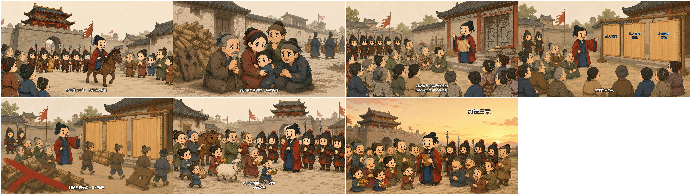
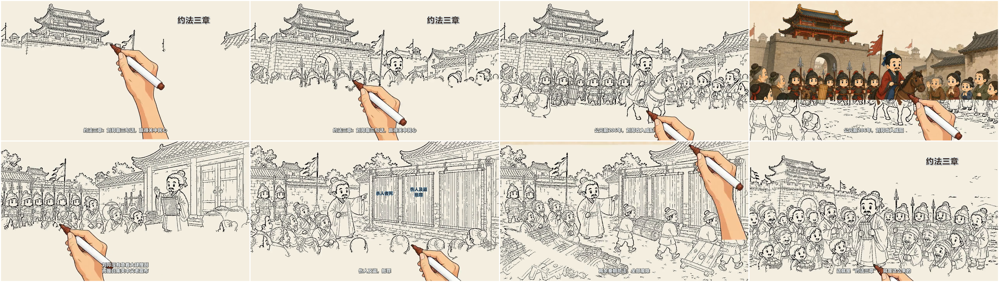

# Three Articles of Law: 16:9 Multi-Scene Stroke Story

The upstream selected landscape version lasts 38.5 seconds at 1920×1080, 30fps. Seven consecutive historical scenes start on blank paper, reveal continuous skeleton ink and color, hold briefly, then transition.

- [Watch original 38.5-second MP4](yuefa-sanzhang-16x9-stroke-story.mp4).
- [Original editable project archive](editable-project.zip): seven color images, annotations, Liu Fei narration, subtitles, deterministic text layers, timeline, and rendered files.
- timeline.json: translated English captions on original seven-scene audio timing.
- verification.json: original video, audio, subtitle, and motion checks.
- seven-scenes-final-frames.jpg and hand-speed-contact-sheet.jpg: original QA images.

Scenes: Liu Bang enters Xianyang, people's fears, gathering Guanzhong elders, announcing three rules, abolishing harsh Qin laws, people rewarding the Han army, and winning Guanzhong's support. The original uses approved Volcengine Liu Fei narration (zh_male_liufei_uranus_bigtts). The upstream report recorded 1,155 decoded frames without automated errors or warnings. This is not a fresh verification of localized output.

The binary MP4, images, and ZIP remain unchanged original-language assets. English captions in the tracked timeline are translations rather than a new English voice alignment. Replace narration and realign before an English-spoken render.

## Why not the old portrait sample?

The old 9:16 canvas crowded historical characters, props, and environment, causing cross-region interference. The selected version uses one coherent event per scene with natural contact and occlusion, avoiding forced grids or sticker islands. Complex historical stories often benefit from 16:9 when portrait is not required. hand-follow 0.35 smooths displayed hand motion, not narration, strokes, or scene duration.

Stroke drawing means algorithmic skeleton tracing and contour-aware coloring, not reproducing a human artist's exact stroke order. It differs from SVG movement, whole-image fades, or zooms.

The archive is for reproducing the example, not a generic story, duration, or character template. After extraction, follow installation instructions and resolve paths for your own machine.
